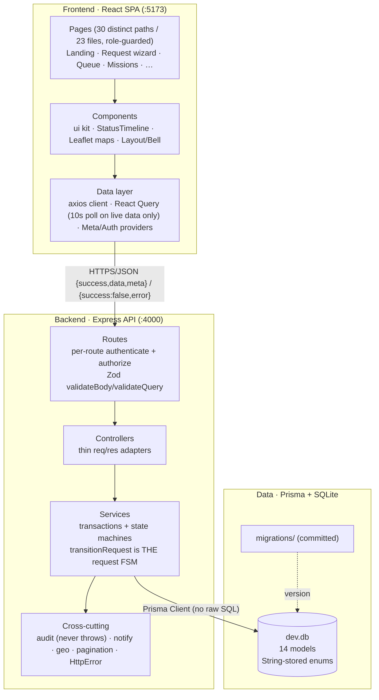
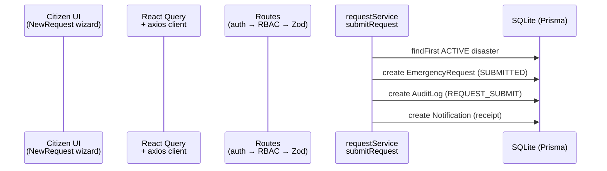
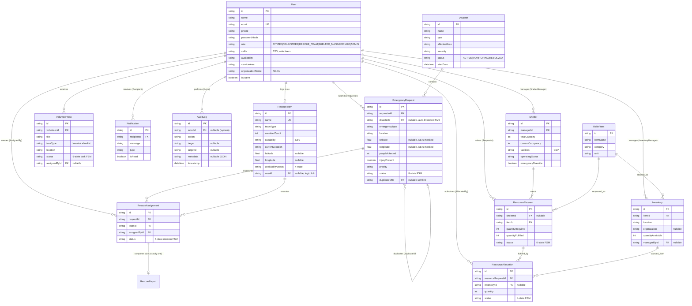

# Architecture — DRRCP Release 1.0

## 1. At a glance

Monorepo (`npm workspaces`): `backend/` (Node 24 + Express 4 + TypeScript +
Prisma 5 + SQLite) and `frontend/` (React 18 + Vite 5 + Tailwind v3). One command
runs both (`npm run dev` → backend `:4000`, frontend `:5173`). See `AGENTS.md`
for the shared contract and `docs/API.md` for the contract surface.

## 2. Three-layer diagram

Request flow through the layers (example: citizen submits):

Key architectural decisions:

- **Single state-machine source.** All status sets and allowed transitions live in
  `backend/src/utils/enums.ts` (`REQUEST_TRANSITIONS` etc.). Display values
  (labels, badge colors, option lists, map-dot hexes, type icons) render from
  `GET /api/meta` — never from literals in pages (enforced by
  `frontend/scripts/check-meta-usage.mjs`, `npm run lint:meta`). Control-flow
  comparisons (`status === 'X'` gates, role arrays, zod mirrors, transition
  maps) stay literal by necessity: they drive types and branching, and meta
  cannot narrow them.
- **No silent failures.** Helpers that must not break flows (`writeAuditLog`,
  `notify`) swallow and log errors. API errors use the `{success:false,error}`
  envelope; the UI surfaces them via toasts/inline alerts and React Query retries
  (except 401/403/404).
- **Derived, not stored, presentation state.** `missionStatus`/`displayStatus`
  are computed per viewer in `decorateRequest`, which also enforces SE-5 privacy
  masking (phone + exact coords only for ADMIN / owner / assigned team).
- **Stateless auth.** JWT (`sub`, `role`), bcrypt-12 hashes, per-route
  `authenticate` + `authorize(...)`. No server sessions → horizontally scalable.
- **Polling over sockets.** 10s React Query refetch on live-watched data only
  (request status, missions, notifications, dashboard; 30s for the trend
  chart); static boards refresh via mutation invalidations, never on a timer.
  Interval ticks pause while the tab is hidden
  (`refetchIntervalInBackground: false`). The notify path is already
  centralized for a future push/SMS gateway (SI-2).

## 3. Entity–relationship diagram (from `prisma/schema.prisma`)

Enforced invariants (code, not just schema): duplicate links suppress independent
dispatch; `quantityFulfilled ≤ quantityRequired`; allocation `quantity ≤
inventory.quantityAvailable` inside one Prisma transaction (cancel restores
stock); occupancy ≤ capacity unless audited `emergencyOverride`; every priority
change, assignment, and allocation writes an `AuditLog` row.

### 3a. Implementation additions beyond the class diagram (R-07)

The checked-in class diagram predates several implemented details; the code is
authoritative and the differences are deliberate, not drift:

- **`AuditLog` model** (`actorId?/action/target/targetId/metadata?/timestamp`,
  indexed on actor/action/target+targetId/timestamp). The diagram has no audit
  entity; every mutating service calls `writeAuditLog()` (FR-18) and the admin
  Audit viewer + request history timeline read it back.
- **Link/foreign-key attributes on existing entities.** `EmergencyRequest`:
  `duplicateOfId` (self-link for DUPLICATE, suppresses independent dispatch),
  `disasterId` (auto-linked ACTIVE disaster), `latitude`/`longitude`
  (SE-5 masked), `injuryPresent`. `RescueAssignment`: `assignedById`,
  `assignedAt`, `completedAt`. `ResourceRequest`: `quantityFulfilled`
  (partial-fulfilment tracking). `ResourceAllocation`: `inventoryId`
  (sourcing stock), `allocatedById` (authorizing user).
- **Derived, never stored:** `missionStatus`/`displayStatus` are computed per
  viewer in `decorateRequest` (no new request states); `availableCapacity`
  (`total − occupancy`) is computed in `withAvailability`.

## 4. Frontend map (pages → roles)

| Area | Pages | Heavy deps (lazy) |
|------|-------|-------------------|
| Public | Landing, Login, Register, Shelters, 404 | maps chunk (Shelters) |
| Citizen | MyRequests, RequestDetail, NewRequest, Nearby shelters (in-shell alias of Shelters) | maps chunk (wizard picker) |
| Admin | Dashboard, RequestQueue, Teams, Volunteers, Shelters, Relief, Alerts, Users, Disasters, Audit | maps + charts chunks (Dashboard) |
| Rescue team | Missions, MissionDetail | — |
| Volunteer | Tasks, Profile | — |
| Shelter mgr | My shelters, Resource requests | — |
| NGO | Inventory, Allocations, Field requests | — |
| Shared | Notifications, Help | — |

Guards: `RequireAuth` (JWT → `/auth/me`) + `RequireRole` (redirect to role home).
Bell polls `unread-count` every 10s. Theme defaults to dark, persisted in
`localStorage`. Code-split chunks: `vendor` (react/router/axios/query),
`forms` (RHF/zod), `maps` (leaflet), `charts` (recharts).
